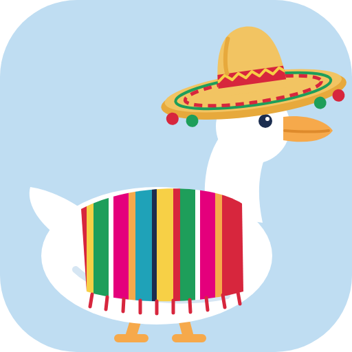
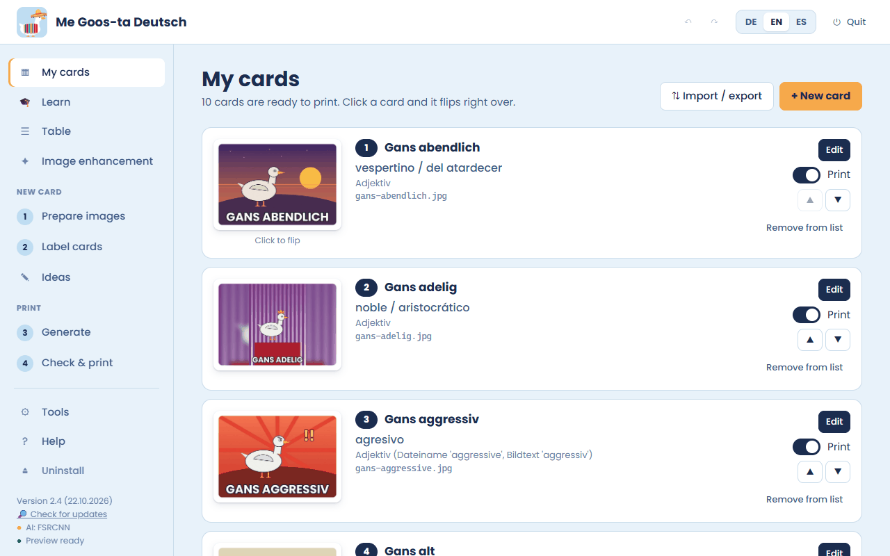
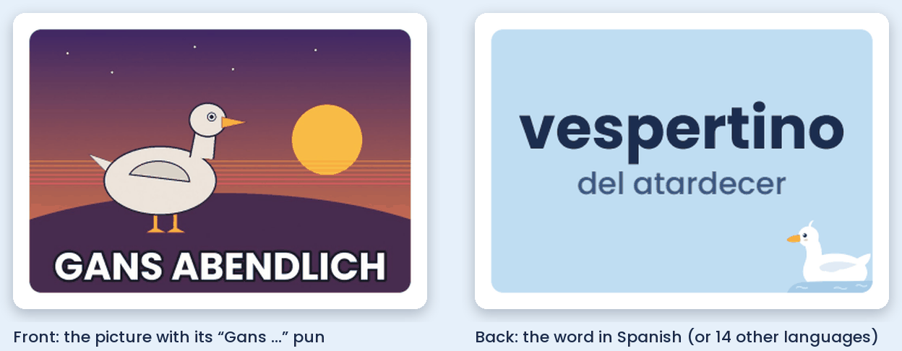
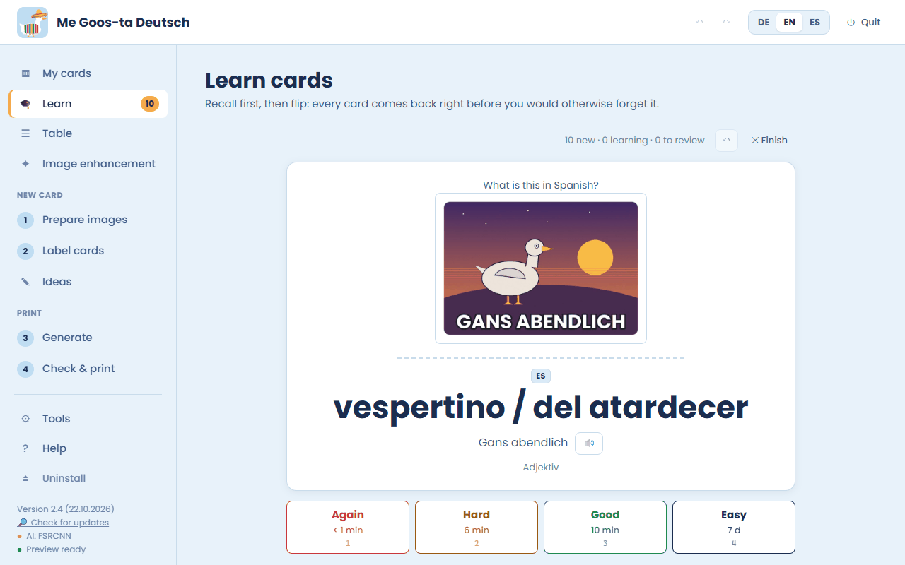
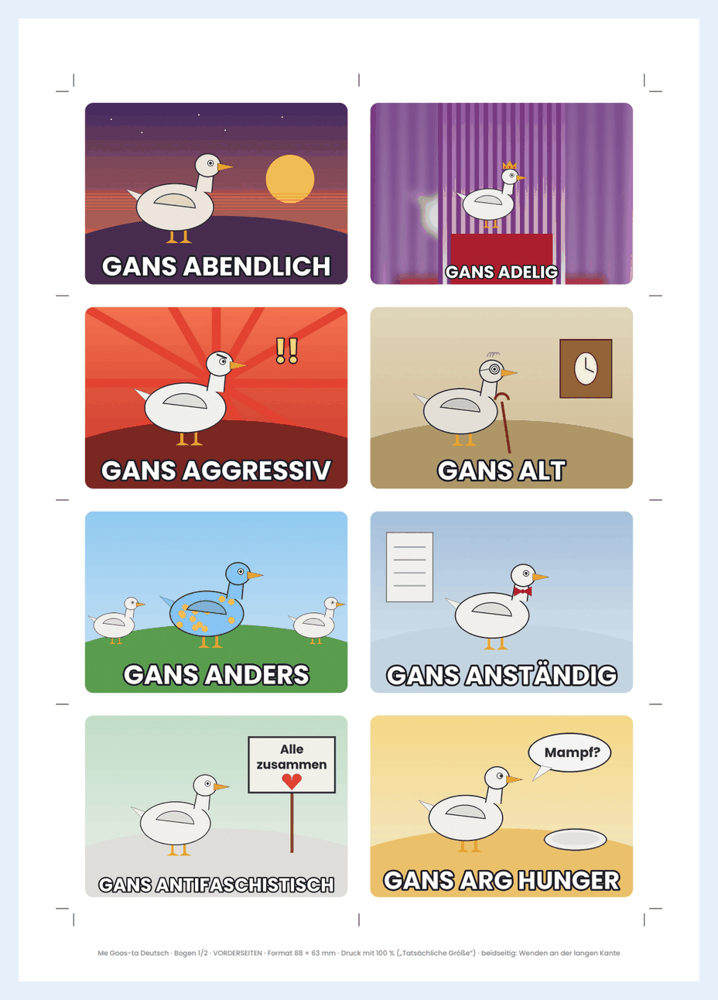
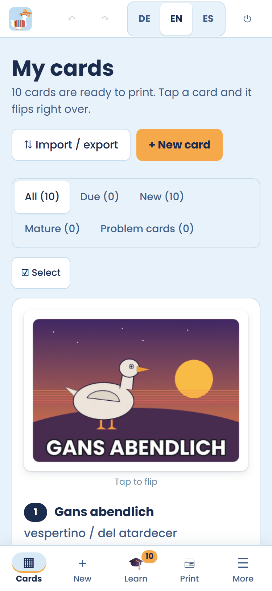

<p align="center"></p>

<h1 align="center">Me Goos-ta Deutsch 🪿</h1>

<p align="center"><b>Learn German with goose puns – picture flashcards to print and to study.</b><br>
<i>Deutsch lernen mit Gänse-Wortwitzen · Aprende alemán con juegos de palabras de gansos</i></p>

<p align="center">
<a href="https://github.com/lukasdiegans/me-goos-ta-deutsch/releases/latest"></a>
<a href="https://github.com/lukasdiegans/me-goos-ta-deutsch/blob/main/LICENSE"></a>
<a href="https://github.com/lukasdiegans/me-goos-ta-deutsch/actions/workflows/tests.yml"></a>
<a href="https://github.com/lukasdiegans/me-goos-ta-deutsch/actions/workflows/release_pruefung.yml"></a>
<a href="https://github.com/lukasdiegans/me-goos-ta-deutsch/actions/workflows/scorecard.yml"></a>
</p>

<p align="center"><a href="https://lukasdiegans.github.io/me-goos-ta-deutsch/download/"><b>⬇️ Download for Windows, macOS and Linux</b></a> ·
<a href="https://lukasdiegans.github.io/me-goos-ta-deutsch/"><b>📱 Phone app</b></a> · free, offline, MIT</p>



Me Goos-ta Deutsch turns pictures with a “Gans …” pun into flashcards: the picture on the front, the word in Spanish –
or one of 14 other languages – on the back, with a little goose paddling in the corner. (“Gans” – goose – sounds just
like “ganz”, “quite”.) Spanish always means Spanish as spoken in Mexico. Print the cards at home or at a print shop, or
learn them right in the program with spaced repetition.



## What it can do

| | |
| --- | --- |
|  | **Learn your cards** with FSRS-6 spaced repetition (like Anki): every card comes back right before you would forget it. 🔊 reads the word and the German text aloud with your system’s offline voices. |
|  | **Print** files for home (A4 or Letter), for print shops (with bleed) and a proof sheet – or go digital: Anki package, offline study page, screen PDF, CSV. |

- **Prepare images** in bulk – format, size and sharpness are checked, AI image enhancement (Real-ESRGAN in pure NumPy,
  no GPU) and realistic AI goose images run offline.
- **Back sides in 15 languages**, translation suggestions only after your consent, ideas and word lists for new cards,
  import/export, undo and redo everywhere, colours & display.
- **Optional tools** are downloaded only when you want them – and removed again just as easily.
- **Update in the program**: Tools → “Keep the program up to date” installs a new, signed version in the same folder.
- Interface in **English, German and Spanish**; runs on Windows 10/11, macOS (Intel and Apple Silicon) and Linux
  (x64 and ARM).

## Get started

1. Open the **[download page](https://lukasdiegans.github.io/me-goos-ta-deutsch/download/)** – it detects your system –
   or take the ZIP from the [latest release](https://github.com/lukasdiegans/me-goos-ta-deutsch/releases/latest).
2. Windows 11: right-click the ZIP → Properties → tick “Unblock”. Extract it.
3. Double-click the start file for your system (`Me Goos-ta Deutsch - Windows`, `… - Mac`, or
   `sh "Me Goos-ta Deutsch - Linux.sh"`). The first start sets everything up by itself: 3–10 minutes, about 90 MB,
   **no administrator rights**, no Python needed beforehand.

`LIES MICH ZUERST.html` in the ZIP explains every step with pictures (EN · DE · ES).

## Phone app



The same program as an installable web app for **Android, iPhone/iPad (iOS 16.4+) and Google Pixel** – no app store,
works offline after the first load, your data stays on the phone:
**https://lukasdiegans.github.io/me-goos-ta-deutsch/**

Alternatively, phone access in your own Wi-Fi lets you use the program running on your computer from your phone
(off by default, PIN-protected, meant for your home network only).

<br clear="right">

## Privacy and security

- **Everything stays on your device** – no account, no ads, no trackers, no statistics.
- **Internet only when needed:** the one-time setup (python.org, pypi.org, github.com), tools you install yourself, the
  update check when *you* click it, and – only after your consent – translation suggestions (just the single word).
  The download page and the phone app are hosted on GitHub Pages, which logs technical data such as IP addresses.
- **Signed releases:** `SHA256SUMS.txt` of every release is signed (minisign/Ed25519, key ID `6885AC6ACBF317E0`); the
  program installs an update only with a valid signature. Releases come from signed tags and are immutable.
- **Pinned packages:** the setup installs the Python packages in exact versions with a SHA-256 checksum for every file
  (`Me-Goos-ta-Deutsch/Programm/pakete.lock`).
- **Local only:** the interface listens on 127.0.0.1 with a secret start key; phone access is optional and PIN-protected.
- Found a vulnerability? Please report it privately: [Security policy](https://github.com/lukasdiegans/me-goos-ta-deutsch/security/policy).

## For developers

| Folder | Content |
| --- | --- |
| `Me-Goos-ta-Deutsch/` | the program exactly as in the release ZIP (`Programm/` with all modules, the interface `ui/index.html`, guides, tests) |
| `web-app-quelle/` | sources of the phone app (service worker, Pyodide start) |
| `werkstatt/` | build and release tools (`bau_release.py`, `bau_webapp.py`, `bau_lock.py`, `ci_lauf.py`, …) |
| `.github/` | workflows (tests on 7 systems + 3 browser engines, release check, Scorecard), CI scripts, community files |
| `docs/` | images for this page |

```bash
python Me-Goos-ta-Deutsch/Programm/test_gans_lernkarten.py
```

```bash
python Me-Goos-ta-Deutsch/Programm/test_erweiterungen.py
```

Every push and pull request is built from source and tested on Windows, macOS and Linux (x64 and ARM), a slim Debian
and in WebKit, Firefox and Chromium; every published release is checked again. How to contribute:
[CONTRIBUTING.md](https://github.com/lukasdiegans/me-goos-ta-deutsch/blob/main/.github/CONTRIBUTING.md) ·
[Code of Conduct](https://github.com/lukasdiegans/me-goos-ta-deutsch/blob/main/.github/CODE_OF_CONDUCT.md) ·
[Changelog](https://github.com/lukasdiegans/me-goos-ta-deutsch/blob/main/Me-Goos-ta-Deutsch/CHANGELOG.md).
The technical specification is `Me-Goos-ta-Deutsch/Programm/SPEC.md` (German).

## Deutsch (kurz)

Me Goos-ta Deutsch macht aus Bildern mit „Gans …“-Wortwitz Lernkarten – vorne das Bild, hinten das Wort auf Spanisch
(oder in 14 weiteren Sprachen). Zum Drucken oder zum Lernen mit Wiederholung im richtigen Moment, für Windows, macOS,
Linux und als Handy-App. Kostenlos, offline, MIT. Download und Anleitung mit Bildern:
https://lukasdiegans.github.io/me-goos-ta-deutsch/download/#de

## Español (breve)

Me Goos-ta Deutsch convierte imágenes con juegos de palabras de gansos («Gans …») en tarjetas: adelante la imagen,
atrás la palabra en español (como se habla en México) o en otros 14 idiomas. Para imprimir o estudiar con repetición
espaciada, en Windows, macOS, Linux y como app del celular. Gratis, sin conexión, MIT. Descarga y guía con imágenes:
https://lukasdiegans.github.io/me-goos-ta-deutsch/download/#es

## License

[MIT](https://github.com/lukasdiegans/me-goos-ta-deutsch/blob/main/LICENSE) © Eine Gans namens Lukas. Third-party
components (Poppins font, FSRCNN and Real-ESRGAN weights, Python packages) keep their own licenses – see
`Me-Goos-ta-Deutsch/Programm/DRITTLIZENZEN.md`.

Have fun learning – you’re doing great! 🪿
